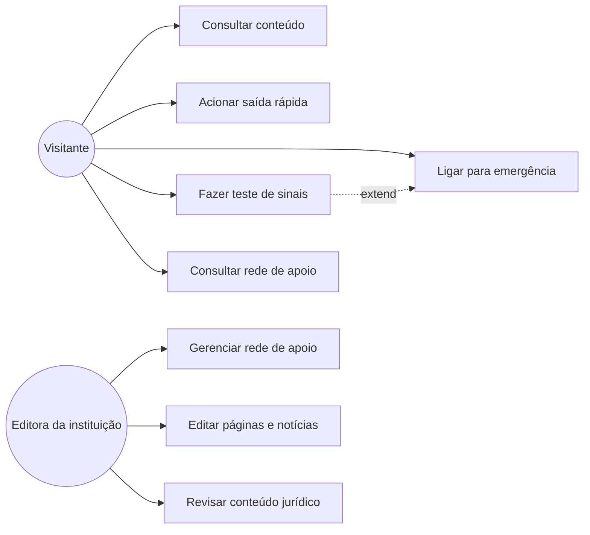

# 04. Especificação de requisitos

Versão 0.1 (preliminar, construída a partir da pesquisa bibliográfica e do benchmark). Deve ser revisada nas atividades 8 e 9 do cronograma com a instituição parceira.

Priorização MoSCoW: **M** (must, obrigatório no MVP), **S** (should, importante), **C** (could, desejável), **W** (won't, fora do escopo desta entrega).

## 1. Escopo

**Dentro do escopo:** site informativo e responsivo, com conteúdo educativo, orientação sobre como pedir ajuda, rede de apoio local editável pela instituição e recursos de segurança para quem acessa.

**Fora do escopo:**
- Aplicativo nativo (Android ou iOS). A solução é um site responsivo, pensado primeiro para o navegador do celular (decisão de 17/11/2026).
- Receber denúncias (o site encaminha para os canais oficiais).
- Botão de pânico com acionamento policial (depende de integração com a segurança pública; o site indica o app oficial do estado, quando existir).
- Cadastro ou login de vítimas.
- Atendimento por chat humano.

## 2. Requisitos funcionais

| ID | Requisito | Prioridade |
|---|---|---|
| RF01 | Exibir botão **Saída rápida** fixo e visível em todas as páginas, que ao ser acionado substitui a página atual por um site neutro sem deixar o Elo Lilás no botão "voltar" | M |
| RF02 | Acionar a saída rápida também pela tecla **Esc** (pressionada duas vezes, para evitar acionamento acidental) | M |
| RF03 | Exibir faixa de emergência em todas as páginas com 190, 180 e WhatsApp do 180, com links que iniciam a ligação ou a conversa no celular | M |
| RF04 | Página **Entenda** com as cinco formas de violência da Lei Maria da Penha, o ciclo da violência e sinais de alerta, com exemplos do cotidiano | M |
| RF05 | Página **Como pedir ajuda** com passo a passo: emergência, denúncia, boletim de ocorrência, delegacia online do estado e medida protetiva sem necessidade de boletim | M |
| RF06 | Página **Rede de apoio** listando os serviços do município (nome, tipo, endereço, horário, telefone, link para rota no mapa) | M |
| RF07 | Filtrar a rede de apoio por tipo de serviço (assistência social, saúde, segurança, justiça, acolhimento) | S |
| RF08 | Exibir em cada serviço a **data da última verificação** dos dados | M |
| RF09 | Página **Seus direitos** com resumo da Lei Maria da Penha, medidas protetivas, **penalidades para agressores** (feminicídio, descumprimento de medida protetiva, crimes informáticos) e linha do tempo das principais alterações | M |
| RF10 | **Teste de sinais de alerta** (autoavaliação) com perguntas de sim e não e resultado orientativo, processado só no navegador, sem salvar respostas | S |
| RF11 | Página **Plano de segurança** com checklist de preparo (documentos, contatos, rota de saída), com aviso sobre o risco de imprimir ou salvar | S |
| RF12 | Página **Como ajudar** para familiares, amigos, vizinhos e colegas de trabalho, incluindo denúncia anônima | M |
| RF13 | Seção **Crianças e adolescentes** com linguagem própria, Disque 100 e Conselho Tutelar | S |
| RF14 | Página **Perguntas frequentes** | S |
| RF15 | Seção **Notícias e campanhas** (Agosto Lilás, 16 Dias de Ativismo, eventos da instituição) | C |
| RF16 | Página **Sobre** com o projeto, a instituição parceira e a relação com a extensão universitária | M |
| RF17 | Páginas de **Privacidade** e **Acessibilidade** | M |
| RF18 | Painel administrativo para a instituição editar páginas, serviços da rede, perguntas frequentes e notícias sem programar | M |
| RF19 | Busca de conteúdo no site | C |
| RF20 | Botão de compartilhar páginas educativas (WhatsApp, link copiado), nunca nas páginas de ajuda pessoal | C |
| RF21 | Contato institucional (parcerias, palestras, voluntariado) por link de e-mail ou WhatsApp da instituição, sem formulário que armazene dados | S |
| RF22 | Aviso discreto no primeiro acesso explicando a saída rápida e como navegar com mais segurança (aba anônima, limpar histórico) | M |

## 3. Requisitos não funcionais

| ID | Categoria | Requisito | Prioridade |
|---|---|---|---|
| RNF01 | Privacidade | Não usar cookies de rastreamento, pixels de redes sociais nem Google Analytics. Se houver métrica, usar ferramenta sem cookies e sem dados pessoais | M |
| RNF02 | Privacidade | Não coletar nem armazenar dado pessoal de visitantes (conformidade com a LGPD por minimização) | M |
| RNF03 | Segurança | HTTPS obrigatório e cabeçalhos de segurança (CSP, HSTS, X-Frame-Options, Referrer-Policy: no-referrer) | M |
| RNF04 | Segurança | Nenhum script de terceiros carregado sem necessidade; fontes e imagens servidas pelo próprio domínio | M |
| RNF05 | Acessibilidade | Atender WCAG 2.1 nível AA: contraste, navegação por teclado, foco visível, textos alternativos, ordem lógica de leitura | M |
| RNF06 | Acessibilidade | Seguir as recomendações do eMAG, já que a parceira pode ser órgão público | S |
| RNF07 | Acessibilidade | Oferecer tradução para Libras (VLibras) | S |
| RNF08 | Usabilidade | Linguagem simples, acolhedora e sem julgamento; frases curtas; nada de juridiquês sem explicação | M |
| RNF09 | Usabilidade | Acesso aos canais de emergência em no máximo 1 toque a partir de qualquer página | M |
| RNF10 | Responsividade | Mobile first, funcional de 320 px a 3440 px de largura | M |
| RNF11 | Desempenho | LCP abaixo de 2,5 s em 4G e página inicial com menos de 1 MB, pensando em celulares de entrada e planos de dados limitados | M |
| RNF12 | Desempenho | Pontuação mínima de 90 no Lighthouse em desempenho, acessibilidade, boas práticas e SEO | S |
| RNF13 | Conteúdo | Imagens acolhedoras, sem cenas de agressão, hematomas ou sofrimento explícito (ver doc 06) | M |
| RNF14 | Discrição | Título da aba, favicon e domínio neutros, sem a palavra "violência" | S |
| RNF15 | Manutenibilidade | Instituição consegue editar conteúdo sozinha após treinamento de até 1 hora | M |
| RNF16 | Manutenibilidade | Código versionado no GitHub, com README de instalação, publicação e manutenção | M |
| RNF17 | Custo | Hospedagem e ferramentas gratuitas ou de custo baixo e previsível para a instituição | M |
| RNF18 | Disponibilidade | Site estático ou com cache, para continuar no ar mesmo com o painel de edição fora | S |
| RNF19 | SEO | Metadados, sitemap e dados estruturados para aparecer em buscas como "como pedir medida protetiva" | S |
| RNF20 | Compatibilidade | Funcionar nas duas últimas versões de Chrome, Safari, Firefox, Edge e Samsung Internet | M |

## 4. Regras de negócio

| ID | Regra |
|---|---|
| RN01 | O site não recebe denúncias nem relatos. Toda ação de denúncia direciona para 190, 180, 100 ou delegacia |
| RN02 | Conteúdo jurídico e orientações só são publicados após revisão de uma pessoa responsável da instituição parceira |
| RN03 | A página de direitos exibe a data da última revisão e deve ser revisada a cada 6 meses ou quando houver nova lei |
| RN04 | Cada serviço da rede de apoio deve ser verificado a cada 3 meses; serviços com mais de 6 meses sem verificação exibem aviso de "confirme por telefone" |
| RN05 | Em risco imediato, a orientação é sempre ligar 190 antes de qualquer outra ação, e isso aparece primeiro na página de ajuda |
| RN06 | O resultado do teste de sinais de alerta é orientativo, nunca diagnóstico, e sempre termina com os canais de ajuda |
| RN07 | O conteúdo usa "mulher em situação de violência" em vez de rotular a pessoa como "vítima" no texto de acolhimento, conforme orientação da rede (validar com a parceira) |

## 5. Histórias de usuário principais

**HU01 (RF01, RF02).** Como mulher que acessa o site escondida, quero sair do site com um toque para que ninguém perceba o que eu estava lendo.
*Critérios de aceite:* botão visível sem rolar a página em qualquer tela; ao tocar, a página é substituída por um site neutro em menos de 1 segundo; o botão "voltar" do navegador não retorna ao Elo Lilás; Esc duas vezes produz o mesmo efeito.

**HU02 (RF03).** Como pessoa em perigo, quero ligar para o 190 ou o 180 direto do site para não perder tempo procurando o número.
*Critérios de aceite:* faixa de emergência visível em todas as páginas; no celular, tocar no número abre o discador; o WhatsApp do 180 abre a conversa.

**HU03 (RF04, RF10).** Como mulher que não sabe se vive um relacionamento abusivo, quero entender as formas de violência e fazer um teste rápido para reconhecer o que está acontecendo.
*Critérios de aceite:* cinco formas de violência com exemplos; teste com até 12 perguntas; respostas não são enviadas a nenhum servidor; o resultado leva para "Como pedir ajuda".

**HU04 (RF05).** Como mulher decidida a buscar proteção, quero um passo a passo de como pedir medida protetiva para saber o que levar e onde ir.
*Critérios de aceite:* informa que não é obrigatório ter boletim de ocorrência; lista documentos úteis; aponta delegacia, Defensoria e delegacia online do estado.

**HU05 (RF06, RF07, RF08).** Como pessoa que precisa de atendimento, quero ver os serviços do meu município com endereço e horário para escolher onde ir.
*Critérios de aceite:* lista filtrável por tipo; telefone clicável; link para rota no mapa abre em nova aba do aplicativo de mapas; data de verificação visível.

**HU06 (RF12).** Como vizinha que desconfia de uma agressão, quero saber como ajudar sem me expor para poder agir com segurança.
*Critérios de aceite:* explica a denúncia anônima pelo 180; orienta ligar 190 em flagrante; lista atitudes que ajudam e que atrapalham.

**HU07 (RF18).** Como assistente social da instituição, quero atualizar telefones e horários da rede sem depender de programador para manter o site confiável.
*Critérios de aceite:* edição por formulário no painel; alteração publicada em até 5 minutos; histórico de alterações disponível.

## 6. Casos de uso (resumo)

| Ator | Casos de uso |
|---|---|
| Visitante (mulher, familiar, público geral) | Consultar conteúdo, acionar saída rápida, ligar para emergência, fazer teste de sinais, consultar rede de apoio, compartilhar conteúdo educativo |
| Editora da instituição | Editar páginas, gerenciar serviços da rede, publicar notícias, revisar conteúdo jurídico |
| Administrador técnico (estudante na fase de projeto) | Configurar hospedagem, domínio, backups e permissões do painel |

## 7. Matriz de rastreabilidade (origem dos requisitos)

### Objetivos específicos da proposta x requisitos

| Objetivo específico (documento complementar) | Requisitos que atendem |
|---|---|
| a) Campanhas de sensibilização junto à sociedade e à mídia | RF15, RF20, RNF19 |
| b) Informar sobre leis, direitos das vítimas e penalidades para agressores | RF04, RF09, RN02, RN03 |
| c) Encorajar vítimas e testemunhas a denunciar de forma segura e confidencial | RF01 a RF03, RF05, RF12, RF22, RNF01 a RNF04 |

### Origem de cada requisito

| Requisito | Origem |
|---|---|
| RF01, RF02, RF22, RNF14 | Benchmark (Find A Helpline, planos de segurança); hipótese da persona Ana |
| RF03, RN05 | Canais oficiais (Ligue 180, 190); lei de divulgação obrigatória do 180 |
| RF04, RF09 | Lei 11.340/2006, art. 7º e alterações de 2023 a 2026 |
| RF05 | Lei 14.550/2023 (medida protetiva sem boletim) |
| RF06 a RF08, RN04 | Objetivo do AVA de fomentar a rede local; persona Juliana |
| RF13 | Proposta do AVA (Azevedo e Guerra, 1995); ECA |
| RF18, RNF15, RNF16 | Exigência do AVA de entregar a solução mantida pela instituição |
| RNF01 a RNF04 | LGPD e risco de monitoramento pelo agressor |
| RNF05 a RNF07 | Público-alvo "público em geral"; eMAG |
| RNF11 | Persona Ana (celular com dados limitados) |

## 8. Questões em aberto para validar com a parceira

1. Qual site neutro usar na saída rápida (previsão do tempo, notícias, busca)?
2. O público principal é mulher adulta ou a parceira quer abranger toda a violência intrafamiliar (crianças, idosos, pessoas com deficiência)?
3. Quais serviços da rede existem no município e quem mantém esses dados?
4. A parceira quer seção de notícias? Alguém publicará com frequência?
5. Termo preferido no texto: "vítima" ou "mulher em situação de violência"?
6. Existe identidade visual da instituição a respeitar (logo, cores)?
7. A parceira tem domínio próprio ou será um subdomínio?
