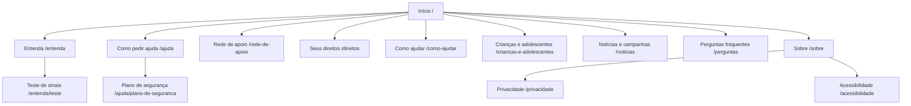

# 05. Arquitetura de informação

Base para a prototipação de baixa fidelidade (Etapa 3).

## Mapa do site

## Elementos globais (todas as páginas)

1. **Botão Saída rápida**: canto superior direito, fixo, cor de alto contraste, rótulo em texto (não só ícone).
2. **Faixa de emergência**: logo abaixo do cabeçalho; no celular, fixa no rodapé da tela: `190 Emergência` · `180 Central da Mulher` · `WhatsApp 180`.
3. **Menu principal**: Entenda, Como pedir ajuda, Rede de apoio, Seus direitos, Como ajudar.
4. **Rodapé**: instituição parceira, extensão UNIASSELVI, privacidade, acessibilidade, data da última revisão do conteúdo.

## Conteúdo por página

### Início
- Mensagem de acolhimento curta ("Você não está sozinha. Aqui você encontra informação e caminhos de ajuda.").
- Três atalhos grandes: **Estou em perigo agora** (190), **Quero entender o que estou vivendo** (Entenda), **Quero ajudar alguém** (Como ajudar).
- Destaque: "Você pode pedir medida protetiva sem boletim de ocorrência."
- Prévia da rede de apoio local.

### Entenda
- O que é violência doméstica e familiar.
- As cinco formas (física, psicológica, sexual, patrimonial, moral), cada uma com exemplos do dia a dia.
- Violência vicária (incluída na lei em 2026).
- Ciclo da violência (tensão, explosão, arrependimento) em diagrama simples.
- Sinais de alerta e chamada para o teste.

### Teste de sinais
- Até 12 perguntas de sim ou não.
- Resultado em três faixas (atenção, alerta, risco) com orientação e canais.
- Aviso: "Suas respostas não são salvas nem enviadas."

### Como pedir ajuda
1. Risco agora: 190.
2. Orientação e denúncia: 180 (telefone, WhatsApp, e-mail, Libras).
3. Boletim de ocorrência: delegacia presencial ou online.
4. Medida protetiva: o que é, quem pode pedir, onde pedir, o que levar.
5. Atendimento psicossocial: CRAS, CREAS, CRAM.
6. Orientação jurídica: Defensoria Pública.

### Plano de segurança
- Checklist: documentos, dinheiro, chaves, contatos de confiança, palavra-código, rota de saída.
- Aviso sobre o risco de imprimir ou salvar o checklist em aparelho compartilhado.

### Rede de apoio
- Cards por serviço: nome, tipo, endereço, horário, telefone, botão "Ver rota", data de verificação.
- Filtro por tipo.

### Seus direitos
- Resumo da Lei Maria da Penha em linguagem simples.
- Medidas protetivas possíveis.
- Linha do tempo das principais alterações (2006 a 2026).
- Data da última revisão.

### Como ajudar
- Sinais de que alguém pode estar em situação de violência.
- O que fazer e o que evitar.
- Denúncia anônima.

### Crianças e adolescentes
- Linguagem direta para adolescentes.
- Disque 100, Conselho Tutelar e escola como pontos de apoio.

## Fluxos principais

**Fluxo 1. Emergência (meta: 1 toque)**
Qualquer página → faixa de emergência → toque em 190 → discador.

**Fluxo 2. Reconhecimento**
Início → "Quero entender o que estou vivendo" → Entenda → Teste de sinais → resultado → Como pedir ajuda → Rede de apoio.

**Fluxo 3. Saída rápida**
Qualquer página → botão Saída rápida (ou Esc duas vezes) → site neutro, sem retorno pelo botão voltar.

**Fluxo 4. Manutenção**
Editora entra no painel → Rede de apoio → edita telefone → publica → site atualizado.
